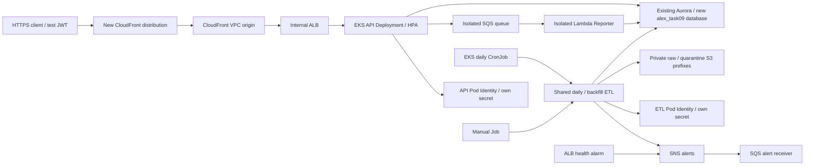

# Bounded EKS acceptance

Run from the repository root. This environment is an eight-hour acceptance window, not an always-on replacement for the current API. Read [cost and ownership boundaries](../../docs/verification/task-09-cloud-window.md) first. Terraform state, credentials, raw data, signing keys and evidence stay under ignored local paths and must not be committed.

## Architecture



The API and ETL use distinct ServiceAccounts, Pod Identity roles, Secrets Manager values and PostgreSQL roles. The API can read validated prices but cannot modify them. ETL cannot modify application users/accounts. Raw and quarantine objects share a private data bucket with different prefixes; the frontend bucket is separate. Quarantine objects are immutable manifests pointing to the original response and its digest, not duplicate frontend assets.

CloudFront terminates viewer HTTPS. Its private VPC connection reaches the internal ALB over HTTP; PostgreSQL uses certificate-verified TLS. This is not a claim of TLS on every hop. New private origin subnets have no Internet route. Workers use existing public subnets and public IPv4 for outbound dependencies, with no public SSH or API ingress. Kubernetes API access is restricted to the operator's /32. The existing Aurora VPC TCP5432 rule is verified read-only and preserved.

## Prerequisites and artifacts

- AWS CLI browser credentials in profile `alex-task09`, operator IAM identity in `default`, Terraform >=1.7, kubectl compatible with 1.35, Docker Linux/amd64, Python 3.12 and uv.
- Existing `alex-aurora-cluster`, its admin secret, the default VPC with two public subnets in distinct supported AZs, and the existing TCP5432 VPC ingress rule. `prepare.py` checks these assumptions and refuses overlapping origin CIDRs. Inspect its output before apply; these are explicit course-environment prerequisites, not a universal VPC provisioner.
- Current billing/credit and a reviewed complete cost estimate. The sample US$20 estimate is valid only for this documented small window; changing capacity/traffic requires recalculation.
- Local `.env` with `MASSIVE_API_KEY` (legacy `POLYGON_API_KEY` is also read). Never put it in Docker build context or manifests.
- A Linux Reporter ZIP whose imports and unavailable-research path have been verified. Rebuild from the checkout with `uv run backend/reporter/package_docker.py` (Docker required; do not pass its deployment option). Record its SHA256 and test it in the Lambda Python 3.12 runtime before use. The task06 artifact is the default; another verified artifact can be supplied explicitly:

```text
uv run --project backend --locked --package api deploy/eks/manage.py reporter --source PATH_TO_VERIFIED_ZIP --sha256 VERIFIED_SHA256
uv run --project backend --locked --package api deploy/eks/test_cloud.py
terraform -chdir=terraform/9_eks init
terraform -chdir=terraform/9_eks test
uv run --no-project deploy/eks/prepare.py
```

`prepare.py` produces private `acceptance.tfvars.json` and live pricing/network evidence under `.local/eks/task09/`. It selects two existing public subnets outside unsupported `use1-az3`, checks unused origin CIDRs, and sets an explicit eight-hour deadline. `ExpiresAt` is not an automatic cleanup mechanism: the operator must stay available and clean up within the window.

API image build, on any authorized Docker computer:

```text
docker build -t alex-api:task09 -f backend/api/Dockerfile backend
```

Only allowlisted sources enter the image. The public RDS trust bundle is from [AWS](https://truststore.pki.rds.amazonaws.com/global/global-bundle.pem); refresh it deliberately when AWS rotates certificates. Build uses a pinned Python base digest and locked uv dependencies. Run credential-free imports before pushing. Authenticate to the task's ECR repository through `aws ecr get-login-password` and Docker `--password-stdin`; use a separate Docker config and log out after the push. Render Kubernetes resources with the **ECR digest**, not a mutable tag.

## Deploy and initialize

Select `AWS_PROFILE=alex-task09` only for infrastructure operations. Preserve the default IAM profile. PowerShell paths containing dots/slashes should be quoted as complete Terraform arguments.

```text
terraform -chdir=terraform/9_eks plan -input=false -var-file=../../.local/eks/task09/acceptance.tfvars.json -out=../../.local/eks/task09/acceptance.tfplan
terraform -chdir=terraform/9_eks apply -input=false ../../.local/eks/task09/acceptance.tfplan
terraform -chdir=terraform/9_eks output -json deployment
```

Save the final output object as `.local/eks/task09/deployment.json` with UTF-8 encoding. Create kubeconfig with `aws eks update-kubeconfig --name alex-task09 --region us-east-1 --profile default --kubeconfig .local/eks/task09/kubeconfig`. The operator receives EKS administration only on this new cluster and an exact-cluster `DescribeCluster` policy. Helpers use `KUBECTL` if set, otherwise `kubectl` on PATH; every helper uses this isolated kubeconfig.

```text
uv run --project backend --locked --package api deploy/eks/manage.py secrets
uv run --project backend --locked --package api deploy/eks/manage.py jwks
uv run --project backend --locked --package api deploy/eks/manage.py render --image ECR_REPOSITORY_AT_SHA256
uv run --project backend --locked --package api deploy/eks/manage.py bootstrap
kubectl --kubeconfig .local/eks/task09/kubeconfig apply -f .local/eks/task09/manifests.json
kubectl --kubeconfig .local/eks/task09/kubeconfig -n alex-cloud rollout status deployment/api
```

Secret initialization refuses existing secret versions. Bootstrap refuses an existing acceptance database, creates marked database/roles, and deletes its temporary Job/ServiceAccount/ConfigMap on success or failure. A partial bootstrap must be inspected; do not rerun it as a reset operation. Secret values never enter Terraform state or Kubernetes manifests. AWS CLI request input uses a temporary local file removed in `finally`; protect the ignored state directory with the current user's filesystem permissions.

## Acceptance and rollback

CronJobs initially have `suspend: true`. Run a bounded real backfill covering the most recently published session first, then a daily Job and verify that repeating it adds no duplicate observations. To validate the scheduler, temporarily set the daily schedule to the next minute, unsuspend, record the controller-created Job and its result, then restore the production `15 0 * * *` `America/New_York` schedule or suspend before cleanup. Provider pacing is 13 seconds per symbol, so 20 symbols take several minutes.

```text
uv run --project backend --locked --package api deploy/eks/manage.py backfill --from YYYY-MM-DD --to YYYY-MM-DD
uv run --project backend --locked --package api deploy/eks/manage.py daily
uv run --project backend --locked --package api deploy/eks/manage.py monitor
uv run --project backend --locked --package api deploy/eks/verify_api.py
uv run --project backend --locked --package api deploy/eks/verify_schedule.py
uv run --project backend --locked --package api deploy/eks/verify_permissions.py
uv run --project backend --locked --package api deploy/eks/verify_operations.py scaling
uv run --project backend --locked --package api deploy/eks/verify_operations.py recovery
uv run --project backend --locked --package api deploy/eks/verify_operations.py rollback
uv run --project backend --locked --package api deploy/eks/verify_operations.py etl-alert
uv run --project backend --locked --package api deploy/eks/verify_operations.py alarm
```

`verify_api.py` uses a locally held signing key and public JWKS in the isolated cluster. It validates HTTPS JSON errors, invalid/expired/forged JWT rejection, account/job ownership and an AAPL snapshot consumed via real SQS/Lambda. It is not a real Clerk browser-login test. The Reporter stores the truthful research-unavailable holdings summary; all five agents and paid research/model calls are outside this window's SQS test.

`verify_schedule.py` automates one manual daily Job plus a controller-created Job, records their identities and checks price/observation counts before and after; it restores the original schedule/suspension setting. `verify_permissions.py` runs `verify_workload.py` in one-off API/ETL Pods with their own ServiceAccount and secret, plus only ARN identifiers and bucket name as test inputs. Forbidden AWS operations must be rejected. The ETL probe writes a deliberately malformed response labelled `task09_fault_injection`, checks quarantine and confirms the count of validated prices is unchanged. It never publishes synthetic valid prices.

Check `kubectl top pods`, HPA current metrics, and load-driven replica changes. Delete one API Pod and record replacement readiness. Introduce an unavailable image only in the task-owned Deployment, record failure, then `kubectl rollout undo deployment/api` and wait for readiness. For alert acceptance, observe a real ETL failure and ALB health failure delivered through SNS to the SQS alert receiver. Save timestamps and received events before restoring healthy service.

The `verify_operations.py` actions automate these checks sequentially. Recovery requires a new Pod UID, the desired replica count and all active Pods Ready. The alarm drill temporarily removes HPA and scales the task API to zero, restores both in `finally`, then observes CloudWatch return to OK. Service metric publication adds latency beyond the two configured 60-second periods; the bounded observation timeout is ten minutes. Run alert consumers sequentially so one cannot consume another's evidence.

The existing API route remains the rollback target throughout. No production DNS/CloudFront change is made. Clients opt into the new endpoint explicitly; switching them back restores the original route. A bad task Deployment is independently rolled back with Kubernetes revision history.

## Cleanup

1. Suspend both CronJobs; finish or remove only their running Jobs. Save API/ETL/metrics/alert logs, S3 raw and quarantine evidence, resource creation times and identifiers under `.local/eks/task09/`.
2. Stop API use and run `uv run --project backend --locked --package api deploy/eks/manage.py database-cleanup`. It refuses to drop anything unless the fixed acceptance database and both roles carry the expected ownership comments. Preserve existing `alex` database and Aurora cluster.
3. Inspect and empty only the task-owned S3 bucket and ECR repository after evidence is archived. Neither has Terraform force deletion enabled.
4. Review a destroy plan for **this** Terraform state and apply it. Keep kubeconfig until workloads and the temporary database have been removed. CloudFront must disable/delete before its VPC origin and ALB can be removed; Terraform handles dependencies.
5. Verify no task EC2 nodes/EBS/ALB/EKS/queues/bucket/ECR remain. Inspect task log groups and EKS-created service resources separately; preserve shared service-linked roles. Secrets remain recoverable for seven days. Compare the original resource inventory and report any retained item rather than claiming complete cleanup.
6. Refresh Billing once AWS posts charges. Elapsed hours and estimates are not actual reconciled billing.
