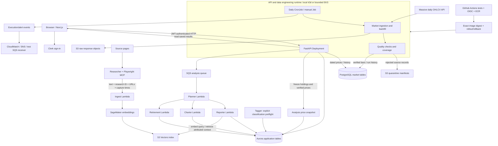

# Platform architecture and deployment boundaries

This is a code-backed component map. It combines capabilities verified in separate acceptance windows; it does not claim every box is currently deployed together. API and ETL are the Kubernetes workloads. The agents remain Lambda workloads.

The delivery arrow means a shared release tool exists. Task10 automatically deploys to disposable **runner Kubernetes**; deployment to EKS is still a controlled operator step. The diagram's Tagger arrow is intentionally separate: the current Planner path orchestrates the three analysis specialists, not an automatic Tagger invocation. Reporter uses SageMaker for query embedding as well as vector retrieval.

| Environment | Runtime and storage | Observed status |
| --- | --- | --- |
| Original course deployment | CloudFront/S3 frontend, API Gateway/Lambda API, original Aurora/Lambdas | Preserved; not upgraded or re-certified by the Task11 run |
| Task7/8 local Kubernetes | API Deployment, ETL Jobs/CronJob, local fixture storage | Verified and cleaned; some fault drills use labelled synthetic input |
| Task9 EKS | Actual EKS API/ETL, S3 raw/quarantine, Aurora market/application DBs, scoped IAM | AWS data/operations verified,67 Terraform resources destroyed; test JWT signer |
| Task10 CI | GitHub-hosted disposable Kubernetes, fixture DB/auth; real OIDC/ECR release | Verified and cleaned; reusable IAM/OIDC/empty ECR configuration retained |
| Task11 showcase | Local Next.js/FastAPI/market PostgreSQL; real Clerk, separate Aurora app DB, SQS and five isolated workers; live embedding/vector resources | Real authenticated analysis verified; see current cleanup status in [Task11](../verification/task-11-showcase.md) |

## Storage responsibilities

**Ordinary S3** stores objects: original market responses, quarantine manifests and, in the original deployment, static frontend files. Raw and quarantine prefixes have separate workload permissions; prefixes alone are not an isolation boundary. Frontend objects and data archives belong to their own deployment buckets. Task11 instead archives market responses on the local filesystem.

**Aurora/PostgreSQL** stores queryable, constrained records: users, accounts, positions, jobs, fixed price snapshots, daily bars, observation versions, runs and execution history. Task9 used dedicated application/market databases and roles on Aurora. Task11 separates the owned Aurora application database from a loopback PostgreSQL market database.

**S3 Vectors** is a separate vector-storage service/resource, even when its bucket name resembles an ordinary S3 bucket. It stores embedded research plus validated metadata; it is neither the source-of-truth price table nor the frontend bucket. **SQS** carries work identifiers and failed messages; it does not replace persistent job state.

Source entry points: [market pipeline](../../backend/market_data/market_data/), [API](../../backend/api/main.py), [snapshot contract](../../backend/database/src/snapshots.py), [research contract](../../backend/research/research_chain/__init__.py), [Kubernetes manifests](../../deploy/eks/manifests.py), [showcase isolation](../../terraform/11_showcase/main.tf), [CI workflow](../../.github/workflows/ci.yml).
